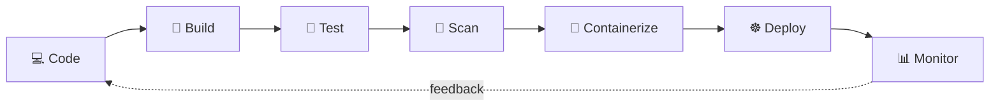

  

<h3 align="center">⚙️ DevOps Engineer · ☁️ Cloud Infrastructure · 🔧 Application Development</h3>

  
  
 

---

## 👋 About Me

- 🎓 MSc Software Engineering student at **Heilbronn University of Applied Sciences**
- 🔭 I design and automate cloud-native systems from the first commit to production
- 🧠 I connect development and operations through automation, monitoring, and Infrastructure as Code
- 📍 Based in Germany · open to remote and hybrid roles across Europe

---

## 🎯 Open To

I'm looking for **entry-level roles** in:

- ⚙️ **DevOps Engineering**: CI/CD · Docker · Kubernetes · Infrastructure as Code
- ☁️ **Cloud Engineering**: AWS · Terraform · Infrastructure Automation
- 🧩 **Application Development**: .NET · Flutter

📩 Email: [ukahn19@gmail.com](mailto:ukahn19@gmail.com) · 💼 [LinkedIn](https://www.linkedin.com/in/muhammadobaidkhan/)

---

## 🔭 What I'm Working On

- 🐳 Packaging applications in **Docker** and running them on **Kubernetes**
- 🔁 Creating **CI/CD pipelines** with **Jenkins** and **GitHub Actions**, with automated tests and security scans
- ☁️ Provisioning **AWS** infrastructure with **Terraform**
- 📊 Setting up monitoring and alerting with **Prometheus** and **Grafana**

---

## 🔁 How I Think About Delivery

---

## 🚀 DevOps Toolbox

### 🔄 CI/CD & Version Control

`Git & GitHub` · `GitHub Actions` · `Jenkins` · `CI/CD Pipelines` · `Automated Testing`

### 🐳 Containers & Orchestration

`Docker` · `Kubernetes` · `Helm` · `Argo CD (GitOps)`

### 🔐 DevSecOps & Code Quality

  
  
  

`SAST` · `DAST` · `SonarCloud` · `Trivy` · `Security Scanning in Pipelines`

### 🏗️ Infrastructure as Code & Cloud

`Terraform` · `Ansible` · `AWS`

### 📊 Monitoring & Observability

`Prometheus` · `Grafana`

### 🐧 Operating Systems & Scripting

`Linux (Ubuntu)` · `Windows` · `Bash` · `Python` · `C#` · `SQL`

---

## 💻 Application Development

### 🟣 .NET / Backend

`C#` · `ASP.NET Core` · `ASP.NET Core MVC` · `Entity Framework Core` · `LINQ` · `RESTful APIs` · `SQL Server` · `Database Design` · `Authentication & Authorization` · `Dependency Injection` · `Middleware` · `CRUD Operations`

### 📱 Flutter / Mobile

`Flutter` · `Dart` · `Cross-platform Mobile Apps` · `REST API Integration` · `JSON` · `State Management` · `Firebase` · `UI Development`

---

  <i>"Automate everything. Secure everything. Monitor everything."</i> 🚀

